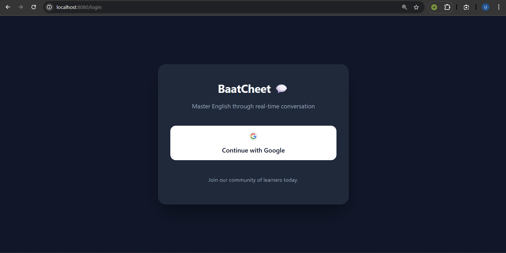
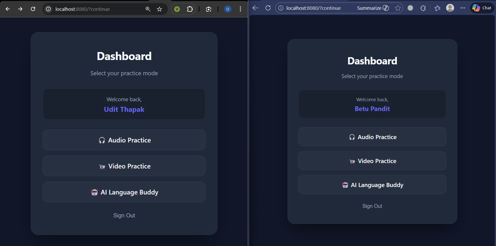
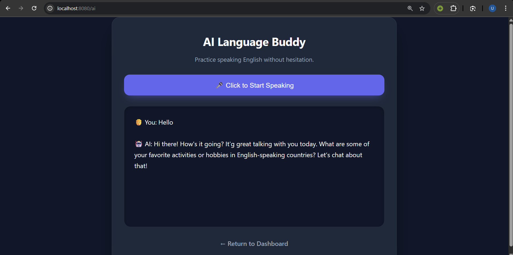
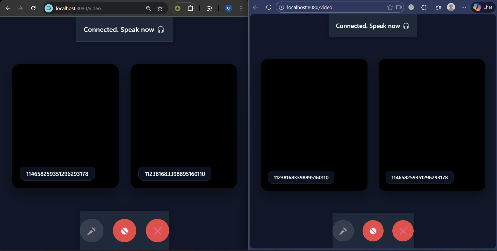

# BaatCheet 💬

[](https://www.oracle.com/java/)
[](https://spring.io/projects/spring-boot)
[](https://webrtc.org/)
[](https://ollama.ai/)
[](LICENSE)

**BaatCheet** is a modern, real-time, peer-to-peer communication web platform designed to help users boost their English fluency and conversational confidence. Practice with random peer partners via low-latency audio/video calls or converse freely with an AI Language Buddy in a judgment-free, privacy-first environment.

---

## ✨ Features

- 🔐 **Secure Google OAuth 2.0** — Fast and authenticated sign-in with Google.
- 📹 **1-on-1 Video Practice** — High-definition peer-to-peer video streaming powered by WebRTC.
- 🎧 **Audio-Only Practice** — Anonymous voice rooms tailored for camera-free practice.
- 🤖 **AI Language Buddy** — Private, local conversational AI powered by Ollama (e.g. LLaMA 3, Mistral).
- ⚡ **Low-Latency Signaling** — Instant peer matchmaking and signaling via Spring WebSockets.
- 🎨 **Modern Glassmorphic UI** — Sleek dark-mode interface with responsive, clean layouts.

---

## 🖼️ Screenshots

| 🔐 Login Screen | 📊 Dashboard |
| :---: | :---: |
|  |  |

| 🤖 AI Language Buddy | 📹 Video Call |
| :---: | :---: |
|  |  |

---

## 🛠️ Tech Stack

### Frontend
- **HTML5 & Vanilla JavaScript** (Native WebRTC API, Web Speech API, WebSockets)
- **CSS3** (Glassmorphism & Dark Mode styling)
- **Thymeleaf** (Server-side templating engine)

### Backend
- **Java 17+**
- **Spring Boot 3.x**
  - Spring Web MVC
  - Spring Security (OAuth2 Client)
  - Spring WebSocket & STOMP / Raw Signaling
- **Ollama REST Integration** (Local LLM inference)

---

## 🚀 Getting Started

Follow these steps to set up and run BaatCheet locally.

### Prerequisites

Ensure you have the following installed:
- [Java JDK 17+](https://adoptium.net/)
- [Apache Maven](https://maven.apache.org/) (or use the included `./mvnw`)
- [Ollama](https://ollama.ai/) (optional, required for the AI Language Buddy)

---

### 1. Clone the Repository

```bash
git clone https://github.com/SrajalJain/BaatCheet.git
cd BaatCheet
```

---

### 2. Configure Google OAuth 2.0

To enable Google Authentication:

1. Navigate to the [Google Cloud Console](https://console.cloud.google.com/).
2. Create a new project or select an existing one.
3. Go to **APIs & Services** > **Credentials**.
4. Click **Create Credentials** > **OAuth client ID** (Application type: *Web application*).
5. Add the Authorized Redirect URI:
   ```text
   http://localhost:8080/login/oauth2/code/google
   ```
6. Copy your **Client ID** and **Client Secret**.
7. Update `src/main/resources/application.yml` (or set environment variables):

```yaml
spring:
  security:
    oauth2:
      client:
        registration:
          google:
            client-id: YOUR_GOOGLE_CLIENT_ID
            client-secret: YOUR_GOOGLE_CLIENT_SECRET
```

---

### 3. Launch Ollama (For AI Buddy)

Pull and run your preferred local LLM model:

```bash
# Pull and start llama3
ollama run llama3
```

*(Note: You can also use other models such as `mistral` by configuring the model name in your backend).*

---

### 4. Build and Run

Run using the Maven Wrapper:

**Linux / macOS:**
```bash
./mvnw clean spring-boot:run
```

**Windows (PowerShell / CMD):**
```powershell
.\mvnw.cmd clean spring-boot:run
```

Once started, open your browser and navigate to:
```text
http://localhost:8080
```

---

## 📁 Project Structure

```text
BaatCheet/
├── .mvn/                                # Maven wrapper files
├── screenshots/                         # Readme previews & assets
├── src/
│   ├── main/
│   │   ├── java/com/baatcheet/
│   │   │   ├── config/                  # Security & WebSocket configs
│   │   │   ├── controller/              # MVC & REST controllers
│   │   │   ├── dto/                     # Request/Response DTO models
│   │   │   ├── service/                 # Business logic & room matching
│   │   │   └── websocket/               # WebRTC signaling handlers
│   │   └── resources/
│   │       ├── static/                  # CSS stylesheets & client scripts
│   │       │   ├── css/style.css
│   │       │   ├── ai.js
│   │       │   ├── audio.js
│   │       │   ├── match.js
│   │       │   └── video.js
│   │       ├── templates/               # Thymeleaf templates
│   │       └── application.yml          # Spring configuration
│   └── test/                            # Unit & integration tests
├── pom.xml                              # Maven build specifications
└── README.md
```

---

## 🤝 Contributing

Contributions make the open-source community an amazing place to learn, inspire, and create. Any contributions you make are **greatly appreciated**.

1. Fork the Project
2. Create your Feature Branch (`git checkout -b feature/AmazingFeature`)
3. Commit your Changes (`git commit -m 'feat: Add some AmazingFeature'`)
4. Push to the Branch (`git push origin feature/AmazingFeature`)
5. Open a Pull Request

---

## 👨‍💻 Author

**Srajal Jain**  
GitHub: [@SrajalJain](https://github.com/SrajalJain)

---

⭐ If you found this project helpful, please give it a star on GitHub!
